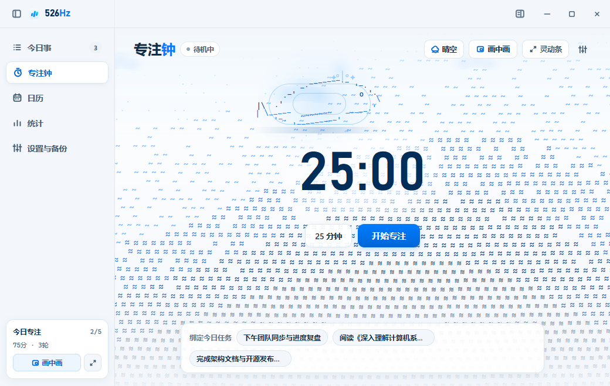
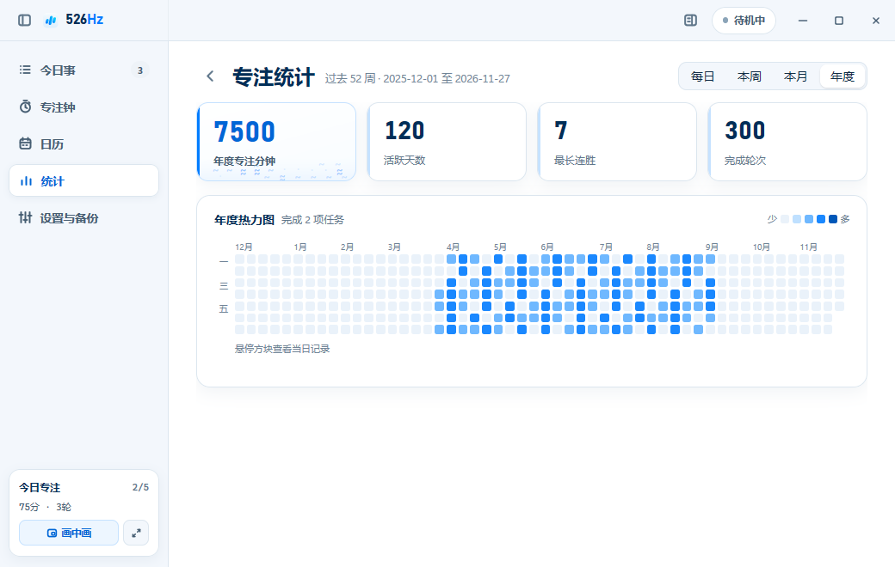

<div align="center">


# 汐 · Xi

**一款纯 Go 原生渲染的桌面专注与待办应用：一张纸，一片用字符写成的海**

零 Electron · 零 WebView2 · 单可执行文件（~15 MB）· 100% 本地优先

[](LICENSE)
[](go.mod)
[](#安装与使用)

汐（xī），夜晚的潮。原名 526Hz，更早叫 Sisyphus；旧版本的数据会被自动沿用。

</div>

---

## 界面一览

| 今日事（纸白 × 海蓝） | 专注钟 · 蓝鲸浮出 |
| :---: | :---: |
|  |  |

| 深色 · 月夜与灯塔 | 年度统计 · 52 周专注热力图 |
| :---: | :---: |
|  |  |

---

## 核心特性

- **极简原生架构**：基于 Go + [`github.com/egoist/mygo`](https://github.com/egoist/mygo)（Direct2D / D3D11 原生 GPU 渲染），不打包浏览器内核，冷启动迅捷、常驻轻量。
- **今日事待办工作台**：
  - 纸白底的页面抬头，底边一条潮水带：它是专注钟那片海的缩小版，待机时满水，专注时随剩余时间下降。
  - 支持子任务拆解、拖拽排序、智能闹钟解析（输入 `16:30 团队同步` 自动设闹钟）、未完自动顺延、每日固定任务模板、提前安排未来日期，以及底部可折叠「已完成」分组。
  - 键盘可达：空格开始 / 暂停，`Ctrl+N` 新建任务，`Ctrl+1…5` 切换页面，任务右键菜单。
- **专注钟与字符海**：
  - 整片海只由 `~ ≈ ≋` 三种字符连续铺成，水位就是剩余时间；背景是一张纸白，没有任何填色。
  - 支持多轮番茄计划、自定义时长、置顶画中画小窗（与主窗共享同一片海）及 `264×50` 悬浮灵动条。
  - **天气决定海况**：晴、雨、雷雨、雾、雪各有自己的浪。雨是落下的字符，闪电是写在天海之间的一道折线，起雾时水面淡入雾中；可选 Open-Meteo 实况天气同步。
  - **昼夜靠光来表现**：清晨与黄昏有贴着海平线的太阳，夜里有月亮和星星，水面上有一道被照亮的光带；阴雨天没有日月。
  - **6 种彩蛋各有出处**：垂钓小船出现在晴或雾的白天，海盗船出现在雷雨中或入夜后，灯塔在夜里或雾与雷雨中点亮，极光属于专注满 50 分钟的晴夜，海豚在晴天专注时出现，蓝鲸在完成一轮专注后浮出。它们浮在真实的水面上，点击有回应，并记入图鉴。
- **立体声程序化天气环境音**：纯 Go 实时合成海浪、细雨、雷雨与微风 4 套立体声环境白噪音，专注计时自动淡入、暂停自动淡出，无需任何外部音频文件。
- **日历、统计与 Markdown 复盘**：
  - 日历视图直接展示每日专注分钟数与任务完成状态。
  - 统计页提供每日 24h 时间轴（支持手写补录与覆写）、周/月时段分布与 52 周纯海蓝年度热力图。
  - 内置 Obsidian / Notion Markdown 复盘模板（每日复盘 / 单任务 / 周报），一键复制或导出 `.md`。
- **本地安全存储与桌面常驻**：
  - 数据 100% 存储在本地（原子写入、滚动备份、一键导入/导出 JSON），默认零网络上传。
  - 支持系统托盘常驻、Windows 开机静默自启（`--start-hidden`），并无缝兼容历史存档目录。

---

## 安装与使用

### 直接下载

前往 [Releases](https://github.com/Stars76/Xi/releases) 下载 `Xi.exe`，双击即可运行，无需安装额外运行时。带版本号的是正式版；名为"预览版"的是随每次提交自动构建的最新版，可能不稳定。

### 启动参数

```powershell
# 默认：打开主窗口并常驻系统托盘
.\Xi.exe

# 静默启动到系统托盘（开机自启默认使用）
.\Xi.exe --start-hidden

# 直接打开置顶专注钟画中画小窗
.\Xi.exe --compact-timer

# 指定独立数据目录运行（用于测试或多配置隔离）
.\Xi.exe --user-data .\my-data
```

---

## 从源码构建（Windows PowerShell）

环境要求：**Go 1.27+**（Windows amd64）

```powershell
# 1. 静态检查（含 mygo UI 框架检查）
go vet -tags mygo_nowebview ./...
go tool mygo vet

# 2. 运行全部单元测试
go test -tags mygo_nowebview -count=1 ./...

# 3. 编译纯原生单文件（产物位于 release\windows-amd64\ 下）
$env:GOFLAGS = "-tags=mygo_nowebview -buildvcs=false"
go tool mygo build -skip-installer
```

---

## 目录结构

```text
Xi/
├── main.go                     # 单实例锁、CLI 参数、数据目录兼容与启动编排
├── mygo.json                   # MyGo 应用元数据（汐 / Xi）
├── resources/icon.png          # 应用图标
├── docs/screenshots/           # README 实景展示图
└── internal/
    ├── assets/                 # 嵌入图标与托盘模板资源
    ├── dateutil/               # 本地日期规范化、顺延差值与 HH:MM 闹钟解析
    ├── store/                  # Schema v2 本地存储引擎（原子写入、滚动备份、导入导出）
    ├── timer/                  # 专注钟状态机、多轮计划与任务闹钟调度
    ├── todo/                   # 今日事、子任务、每日模板与未完顺延
    ├── stats/                  # 日/周/月/年统计、24h 时间轴与 52 周热力图聚合
    ├── notes/                  # Obsidian / Notion Markdown 复盘模板引擎
    ├── sound/                  # 纯 Go 实时立体声环境白噪音与微音效合成
    ├── weather/                # Open-Meteo 实时天气查询客户端（可选开启）
    └── uiapp/                  # 界面、字符海（海况、天气、昼夜、彩蛋）与托盘；设计规则见 design.go
```

---

## 开源协议

本项目基于 [MIT License](LICENSE) 开源。
